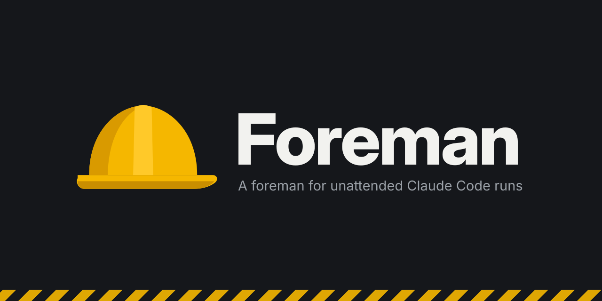

# Foreman

A foreman for unattended Claude Code runs.

**Give Claude Code a plan, walk away, and come back to finished work: every unit built, checked and committed, with a report of what it decided and what it needs from you.** Not to a "shall I continue?" it asked five minutes after you left.

Claude Code can already do hours of planned work on its own. What stops it is that it hands control back too early: it asks which task is next, asks before committing, and says "done" without proof. Foreman takes that away. A stop is refused until the project check passes and the plan has moved, and a second model refuses any stop that is not a real decision or a real blocker. Each gate gives way after three refusals and records why, so a stuck run still comes back to you. It is built from Claude Code hooks, because instructions in `CLAUDE.md` alone proved too easy to drift from.

Use it when you have a reviewed plan, a project check that fails when something is broken, and work that needs your local machine. Skip it for exploratory work, where the questions are the point.

Status: a personal tool shared as is, under the MIT licence (`LICENSE`). Nine runs so far, about 70 units, all by one person on two projects. Runs tested with Claude Code 2.1.312, `/foreman:review` with 2.1.316; hooks depend on Claude Code's behaviour, so a later version may break something. Issues and ideas are welcome; support is not promised.

---

## Why it exists

Without Foreman, the session decides when it is done, and it decides too often and too early. With Foreman, a stop has to be earned: the project check passes, the plan has moved, and a second model agrees the reason for stopping is one only you can resolve.

### The problem, measured

It started from measuring how we actually worked, over 18 days of Claude Code sessions on a client project:

- 46 hours at the desk, a prompt needed every 5.5 minutes, never more than one session at a time
- 44% of that time was us reading and typing, not the model working
- of 73 long turns, 28 ended with a sequencing or housekeeping question ("X or Y next?", "shall I commit?", "say the word") that we answered with "go"; another 14 ended with us reviewing a result

Permission prompts were not the cause; the sessions already ran in `auto` mode. The model could do the work. It kept handing control back. Rules against that in `CLAUDE.md` held for a while and then drifted, which is why every rule a program can check is a hook here, and prose is kept for judgement a hook cannot make.

The scarce resource is your attention, not the model's ability or tokens. The aim is to start a run, leave, and come back to a report.

### Why not something that already exists

| Option | What it solves | Why it was not enough for us |
|--------|----------------|------------------------------|
| `auto` mode, skipping permissions | Permission prompts | Not the problem, as measured above |
| Prompt-level orchestration (plan-execution skills, workflow frameworks) | The plan, and "do not check in between tasks" | It is prose, the same soft rule that drifted. Foreman runs underneath these: it uses their plans and adds the hard gate |
| "Keep going" loops (a Stop hook that feeds the prompt back until a completion phrase appears) | Stopping too early | Nothing checks that "done" is true, a legitimate stop cannot be told from a lazy one, and there are no per-unit commits or decision records. The closest relative: the same mechanism without the verification |
| Cloud coding agents | Unattended work, real isolation, parallel runs, pull requests | They cannot reach the local environment our units need: VPN, SSH tunnels, a local stack in Docker Compose, a browser on the local dev server. They also decide "done" themselves |
| CI as the gate | Proof after a push | It catches the problem after the session has ended and lost its context. Foreman enforces the check while the session can still fix it |

### What it adds

1. **A stop has to be earned.** Check, screenshot of changed screens, resume point, then the judge. Cheap decisions are made and logged, expensive ones are parked, and the run moves to the next unit.
2. **A gate that has never failed proves nothing.** `/foreman:init` compares the check with everything the repository has, and proves with a canary that each gate (tests, types, linters, formatters, migrations, docs builds) can actually turn it red, or says which it could not prove. On the first project, the audit found that `make check` did not run the frontend tests at all.
3. **A hand-back you can review later.** Commits per unit, a decisions log, parked questions and a fixed opening line. You come back to a report, not a chat history.
4. **It cannot switch itself off quietly.** Approved declarations, a guard on its own files, and a doctor at every session start.

### What to expect, honestly

- **The evidence is thin.** Nine runs, one person, no control group. So far: every stop-gate block was resolved by the session without help, and the main context grew by about 50k to 80k tokens for 6 to 8 units (about 106k for the 9-unit run). Whether it reduces time at the desk has not been measured yet.
- **Running locally cuts both ways.** The access that makes local runs worth it (tunnels, the real stack) also means no isolation; see "What it does not protect" below.
- **Parts of it will become redundant** as Claude Code and the models improve. The verification parts (the earned stop, the proven check) should last longest.

---

## What you get

| Part | What it does |
|------|--------------|
| Stop gate (`Stop` hook) | In a project with an approved `.foreman.toml`, at every stop after the tree changed, run or not: refuses the stop until the project check passes and changed frontend screens have a screenshot. During a run it also requires that the plan's resume point has moved, and a small model (Haiku) must agree the stop is legitimate: run complete, blocked on you, or a decision only you can make. A stop while subagents are still working is a wait and is not checked. After 3 refusals of one step in a turn, the next stop passes and the reason is recorded. A hand-back pauses the run: while paused the resume point and the judge are skipped, except for `Run complete:`. The next subagent launch the unit gate lets through resumes it. |
| Unit gate (`PreToolUse` hook on `Agent`) | During a run, paused or not, runs the project check before the next subagent starts, the one moment the previous unit is finished and nothing writes to the tree. It skips the check when this tree already passed or another subagent is still writing. A failing check refuses the launch with its output; after 3 refusals it lets the launch go and records why. Subagents' own subagents are not gated. |
| Guard (`PreToolUse` hook) | Forces a permission prompt before a push to a protected branch, a merge of a pull request, `git clean -x`, `git stash --all`, switching off or removing a plugin, or any edit of Foreman's own files or your Claude Code settings. It runs in every repository, with or without `.foreman.toml`; in a project whose `.foreman.toml` is not approved, every push asks, because the protected branches are unknown. It asks rather than refuses, except that it blocks the call when it crashes, cannot load, or runs out of time. It also covers subagents' tool calls. |
| Doctor (`SessionStart` hook) | At every session start and after compaction, says whether Foreman is intact for this project and, during a run, its units, whether it is paused and what resumes it, local ports held by tunnels, and the run contract again. |
| `/foreman:init` skill | Audits a repository's checks, proves each gate can fail (a canary per gate), proposes fixes and writes `.foreman.toml`. |
| `/foreman:run` skill | Starts a run on one plan, or a chain of plans on stacked branches. Each unit goes to a fresh subagent so the main context stays small. |
| `/foreman:report` skill | Checks each run in the gate log against what the gates promise and prints a report without content, ready for an issue. |
| `/foreman:review` skill | Reviews one run from its transcripts on your machine: a private review for you, and a redacted issue for Foreman's maintainer that you read before posting. |
| Run contract | The rules a session follows during a run (commit per unit, decisions log, parked file, hand-back). It enters the conversation only when a run starts, so sessions without a run never carry it. |

---

## Requirements

- Claude Code with the `claude` CLI on `PATH` (the judge runs `claude -p --model haiku` on stops during a run, on your plan or API key; `FOREMAN_JUDGE_MODEL` picks another model)
- [uv](https://docs.astral.sh/uv/) and Python 3.12 (uv fetches it if needed)
- git; macOS or Linux
- A project with a check command that is fast enough to run after every unit and that actually fails when something is broken (`make check`, `npm test`, ...). Without one Foreman has little to hold the session to.
- Plans with numbered units and a resume point, for example from the superpowers `writing-plans` skill.

---

## Install and uninstall

It is a Claude Code plugin. This repository is both the plugin and a one-plugin marketplace. From GitHub:

    claude plugin marketplace add michalzan/foreman
    claude plugin install foreman@michalzan

or from a clone, with `claude plugin marketplace add ~/path/to/foreman` as the first line. Start a new session afterwards.

To update: from GitHub, `claude plugin marketplace update michalzan` and then `claude plugin update foreman@michalzan`; from a clone, `git pull` is enough, because a marketplace added from a local path is loaded in place. Either way, quit `claude` and start it again: Claude Code reads the hook registrations once, when it starts, and `/clear` keeps them. A process started before an update runs the new scripts under the old registrations, so a hook added since never runs. The doctor says so at session start, and during a run the stop gate holds the session until it hands back. A GitHub install only updates when the `version` in `.claude-plugin/plugin.json` goes up, so releases are deliberate and a half-finished commit does not reach your sessions.

To remove it:

    claude plugin uninstall foreman@michalzan
    claude plugin marketplace remove michalzan

Nothing is written into your `~/.claude/settings.json` hooks or your `CLAUDE.md`; Claude Code records the plugin under `enabledPlugins` and `~/.claude/plugins/`. In a project without an approved `.foreman.toml` the stop gate and the unit gate are off. The guard stays on everywhere: merges of pull requests, `git clean -x`, `git stash --all`, plugin changes and edits of your Claude Code settings ask in every repository. Your approvals (`~/.claude/foreman-trusted.json`) and every project's files stay when you uninstall.

Upgrading from the version before the plugin, when Foreman was called the harness and was installed with `install.py`? Remove that copy first, or its hooks run beside the plugin's (the doctor says so):

    uv run --python 3.12 uninstall.py

A project set up before 2026-10-27 has the old file names (`.harness.toml`, `.harness/`), and Foreman leaves its gates off there; the doctor says so. Move them once per project, commit the rename, and approve the declaration again:

    uv run --python 3.12 migrate.py ~/path/to/project

Your old approvals file, `~/.claude/harness-trusted.json`, is no longer read; delete it when you like.

Run the tests with `uv run pytest`.

---

## Using it

1. **Set up a project once:** in the project, run `/foreman:init`. Review what it proposes, then read the `.foreman.toml` it writes and approve it when the guard asks. Until it is approved, and again after any change to it, the stop gate and the unit gate are off for that project, and the guard asks before every push there.
2. **Write a plan** with units and a resume point, and review it yourself. The run builds what the plan says; a bad plan gets built well.
3. **Start a run in a fresh session:** quit and start `claude` again, then

        /foreman:run docs/plans/my-plan.md
        /foreman:run docs/plans/a.md docs/plans/b.md     # a chain: b is built on top of a

4. **Come back to the hand-back.** The last message opens with `Run complete:`, `Blocked on you:` or `Decision needed:` and lists the units done, the decisions made (in the decisions log) and the questions parked.

5. **Check that Foreman did its job:** `/foreman:report` reads the project's gate log and checks every run against what the gates promise. It checks that the hooks were loaded as installed, that the unit gate decided before every subagent launch, that no gate gave up, that the judge was available, that the check passed at the end, and that the run handed back. The log holds only structure (steps, decisions, durations), and so does the report, so after reading it you can paste it into an [issue](https://github.com/michalzan/foreman/issues).

6. **Find out why a run went the way it did:** `/foreman:review` reads the run's transcripts on your machine and writes its files in `.foreman/review/<run start>/`. Two are for you to read: `private.md`, a private review of the run, and `issue.md`, an issue about Foreman's behaviour in which commands are reduced to their shape and common secret formats are replaced. If a name the script knows (your project, remote, branches, user, machine) is left in the issue, it is marked in place and the issue is headed NOT READY. It costs about 80k tokens for the reviewing subagent. Read `issue.md` before you post it: the script cannot know every name.

7. **Continue a paused run from a new session if you like:** a run paused at a hand-back can be picked up from a new session. The next subagent launch takes the run over.

Do not `/clear` or re-run `/foreman:init` during a run: the run belongs to the session of its first stop, and a session started by `/clear` after that is not judged until it takes a paused run over. Merging into protected branches stays your job.

---

## What it does not protect

Read this before you leave a run alone.

- **The guard reads commands like bash, but it is not bash: a speed bump, not a sandbox.** It follows quotes, separators, redirects, heredocs, `$(...)`, nested `bash -c` and `eval` strings, `cd` and variables set in the same command, and resolves every path a known writing command touches (`rm`, `mv`, `cp`, `sed -i`, `perl -i`, `tee`, `git checkout`, ...). It cannot see what a program decides for itself: a Python or Node script that writes a file, `eval` of a variable set elsewhere, git aliases or `push.default` from your config, a branch name read from a file, a `cd` inside a subshell, `tar -C` or `find -delete` with a pattern that happens to match. A writing command with a path it cannot resolve asks when the command names one of Foreman's files. One script of Foreman's own is such a route: `export.py`, used while developing Foreman, rewrites the installed plugin without a prompt. Where the answer matters and it cannot work one out (a push to a branch it cannot read, a branch switched to one it cannot read, a write after a `cd` it cannot follow, a shell fed by another program such as `curl … | sh`, a quote left open, nesting deeper than it reads), it asks; a command it cannot read within 7 s is blocked; commands longer than 200,000 characters always ask. Replayed over the 448 Bash commands of one real nine-unit run, the previous version asked once and this one not at all. Use it to catch mistakes, not an adversary. Run in `auto` or a similar permission mode you already trust.
- **A plan whose units run without subagents has nothing to resume it after a hand-back:** the check still holds, the judge and the resume gate do not.
- **A declaration changed by git holds the run.** `git checkout`, `reset` or `pull` can change `.foreman.toml` without naming it, so the guard does not ask. The changed file no longer matches your approval; during a run the stop gate and the unit gate then hold the session until the approved version is restored or it hands back with `Blocked on you:` or `Decision needed:` (a paused run is held only at the next subagent launch), and after 3 attempts they let go with a warning and the gates stay off until you approve it again. Outside a run it is a warning at each stop and at the next session start.
- **Nothing isolates the network.** An unattended session can reach everything your shell can: SSH tunnels, VPNs, cloud credentials, local ports. In one pilot run, a simulator's default port was held by an SSH tunnel to a production server, and test traffic went there before the session noticed. When a run starts, and in the doctor during a run, Foreman lists local ports held by `ssh`, `autossh`, `kubectl`, `cloudflared` or `socat`; it does not close them. Close tunnels you do not want a run to use, and give local test services ports nothing else uses.
- **Approving `.foreman.toml` means trusting its check command.** The unit gate runs that command before every subagent launch, and the stop gate at stops after the tree changed, run or not. Read it before you approve.
- **The judge is a small model.** It was tuned on 21 constructed cases and blocks most "shall I continue?" stops, but it can be wrong both ways. Three blocks per step, then it lets the session stop and records a warning.
- **If a hook crashes, the stop gate lets the session stop and the unit gate lets the subagent start** (both fail open) while the guard blocks the call (fails closed). The doctor reports a broken plugin at the next session start. A plugin that is disabled cannot report anything: check `claude plugin list` if the gates seem quiet.

---

## Files

    .claude-plugin/   plugin.json (the plugin) and marketplace.json (this repository as a marketplace)
    hooks/            hooks.json, launch.sh (finds uv), the hooks and their shared modules
    skills/           init, run, report and review, invoked as /foreman:<name>
    run-contract.md   the rules of a run, printed when a run starts
    uninstall.py      removes the pre-plugin install
    migrate.py        renames a project's files from the harness era
    assets/           the image at the top of this file
    pyproject.toml    the test setup
    LICENSE           MIT
    tests/
